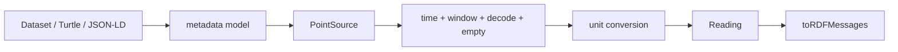

# Implementation notes

Working notes for building `rdf-tss`. The API is in [README.md](README.md); the rules are in the [spec](https://knowledgeonwebscale.github.io/rdf-timeseriessnippets/). Where the two disagree, the spec wins.

## Principles

- **Read path first.** Readers need little code and no Node-only APIs; writing is a separate module.
- **Core runs in Node and in the browser.** It uses only `fetch`, `ReadableStream`, `TextDecoder` and `AbortSignal`. Anything that touches the file system (local `open`, `create`, locks) sits behind a `Storage` interface and is exported under the `node` condition of `package.json#exports`.
- **Few dependencies, heavy ones optional.** Parquet, Arrow and eyemind are loaded with dynamic `import()` and declared as optional peer dependencies. A user who only reads embedded or CSV snippets pays nothing for them.
- **Values stay text.** Every value is a lexical form plus a datatype IRI until the user calls `toNative()` or asks for a unit conversion.
- **Never reason per reading.** Reasoning (eyemind) runs on metadata only; per-reading work is plain arithmetic.

## Architecture

1. **Metadata model.** Parse the RDF/JS `Dataset` into a typed `SnippetMetadata`: class, fields, time field, window, `mutable`, summaries. Field lookup by local name (the part after the last `#` or `/`) or IRI is built once; an ambiguous local name throws only when it is used. Describing fields (`tss:describesField`) are ordinary fields; expose the link in `metadata`.
2. **`PointSource`.** One interface, `AsyncIterable<RawPoint>`, where a `RawPoint` maps field to a lexical string or `undefined`. One implementation per class:

   | Class | Source |
   |---|---|
   | EmbeddedRDF | `tss:hasPoint` nodes; field IRI is the predicate; sorted by time (the spec says embedded points are unordered) |
   | EmbeddedJSON | `JSON.parse` the `rdf:JSON` literal; keys are `tss:columnName`; `null`, missing and `""` are empty |
   | CSV | own streaming RFC 4180 parser (about 100 lines): custom delimiter, `TextDecoder` for `tss:encoding`, header by name or `tss:columnIndex` |
   | Arrow | `apache-arrow` `RecordBatchReader`, which reads both IPC formats; dictionary columns read as their values |
   | Parquet | `hyparquet` (pure JS, works in browsers, range reads) |

   Arrow and Parquet cells are converted to the lexical forms in the spec tables (§ 6.2, § 6.3), e.g. timestamps to `…Z` in UTC, decimals with exactly `scale` digits.
3. **Pipeline stages**, in order:
   - Resolve the time: a column, or `timeBase + n × timeStep` for a time grid. Duration arithmetic has calendar semantics (`2021-01-31 + P1M` is `2021-02-28`), so write and test it explicitly.
   - Keep rows in `[from, until)`.
   - Decode values: `tss:DeltaFromBaseline` is `baseline + value`, computed on exact decimals (a small `BigInt`-scaled decimal type, or `big.js`), never on floats.
   - Apply the empty-value rules (empty cell, null, missing key, `""`).
   - Convert units if requested.

   Times are compared as moments, not as strings. Parquet and Arrow can hold nanoseconds, so use an `Instant` backed by a `BigInt` of epoch nanoseconds instead of `Date`.
4. **`toNative()`.** Integer types become `number` when safe and `bigint` otherwise; `xsd:decimal` becomes `number` and is documented as lossy; dates become `Date`; booleans accept `true`, `false`, `1`, `0`.
5. **`toRDFMessages`.** Implements spec § 8 for measured fields only (fields with `tss:observedProperty`), with the § 8.1 SOSA/QUDT/Dublin Core mapping as the default `ObservationMapper`.
   - Every `Reading` holds a reference to its snippet, so the mapper has the snippet IRI and the field metadata (property, sensor, feature of interest, datatype).
   - Take the result literal from `Value.value` and `Value.datatype`, and the unit from `Value.unit`, never from the field's `tss:unit`: after a conversion the field's unit is wrong. Never go through `toNative()`, which would turn `"2.50"` into `2.5`.
   - Use a blank node per observation. Write `sosa:resultTime` as `xsd:dateTime`, as the spec's example 2 does (the range of `sosa:resultTime`); the text is the time as published.
   - Spec step 5: also output the concise bounded description of each IRI the observations use (observed property, sensor, feature of interest, unit), without TSS terms. Compute it once per field and cache it. The `description` option controls whether it goes in the first message (default), in every message, or nowhere.
   - Non-measured fields and describing fields produce nothing; the spec has no property to map such a column to a linked data term (possible spec issue).
   - Test with spec examples 1 and 2 (embedded snippet and its expansion) as fixtures.

## Following a live snippet

`tss:committedUntil` is proposed for removal (issue #20), so `follow` must not rely on it. Detect change per source instead:

| Source | Change detection |
|---|---|
| CSV, Arrow stream (append-only) | remember the byte offset; poll with `HEAD` / `If-None-Match` / `ETag`, then `Range: bytes=offset-` and parse only the new bytes. Ignore an incomplete last line until it ends with a newline. |
| Embedded | refetch the document, emit points not yet seen (the key is unique, so the set of seen times is enough) |
| Local file | `fs.watch` with a polling fallback on size and mtime |

End conditions: `tss:mutable false` read after the last poll, a point at or after `until` seen, or `AbortSignal`. Back off on errors; honour `interval`.

## Writing (Node only)

- **Order of a write**, as in spec § 9: validate the new points, add them, widen the window, recompute summaries, and keep the change only if the snippet still conforms. Until the spec drops `tss:committedUntil`, a conforming writer must still set it on every write; readers ignore it.
- **Atomicity.** Validate in memory first. For external files, append the whole batch in one `write` and `fsync`. For metadata, write a temp file and `rename`.
- **Embedded RDF** could append one Turtle statement per point, but the window and the summaries change existing triples, so rewrite the whole document at first.
- **Lock.** A lock file created with `O_EXCL` (`wx`) holding pid and timestamp, with stale-lock detection; `LockError` if it exists. Provisional until the spec defines single-writer behaviour.
- **Summaries.** Count, missing, min, max and mean update incrementally. The median needs all values, so recompute it by re-reading, or keep a sorted array in memory. Because that costs O(n) per write for large external files, consider recomputing on `close()` only and documenting the deviation.
- **Parquet** is written once on `close()`: `hyparquet-writer`, always frozen.
- **Arrow formats.** The spec (§ 6.3) says the IPC *file* format, which cannot be appended to. For now the library assumes the IPC *streaming* format: it is the only one that can be appended to and followed. The IPC file format is also read, but only when the snippet is immutable (`tss:mutable false`). A mutable snippet with an IPC file throws `ValidationError`, and `open` with `write: true` on an immutable one throws `NotWritableError`. Detect the format from the first bytes: a file starts with `ARROW1`, a stream with the continuation marker `0xFFFFFFFF`. When appending to a stream that ends with the optional end-of-stream marker (`0xFFFFFFFF 0x00000000`), overwrite those last 8 bytes with the new batches; readers must also accept streams without a marker. An issue for the spec is pending.
- **`Storage` interface** (`read`, `append`, `replace`, `lock`) so that a remote target (LWS/POST) can be added later.

## Validation

- One rule per spec requirement, each returning `{ rule, node, message }` entries for the `Report`. `ValidationError` carries the report.
- Cardinality and "required/optional/not allowed per class" come from the spec's property tables (§ 3, § 4). Encode them as a data table with one generic checker rather than as hand-written ifs.
- Lexical-form checks for the datatypes listed in § 4.1 (doubles, integer family, booleans, `xsd:dateTime*`, `xsd:date` including real days).
- Optional: express the structural shapes as SHACL and run them with eyemind's `--shacl` profile (SHACL 1.2 Core), so other implementers can reuse the shapes. Time-window, uniqueness and data-file rules stay in TypeScript.

## eyemind

[eyemind](https://www.npmjs.com/package/eyemind) 0.8.4 is a dependency-free Logic Script reasoner (Node 18 or later, also runs in the browser, MIT). It reads Turtle, TriG, N-Triples, N-Quads and N3 as `rdf(S, P, O, G)` facts, and ships RDF logic profiles: `--qudt` (normalize QUDT quantity values and CDT literals to SI units from an offline catalog adapted from QUDT.org, CC BY 4.0), `--owl2rl` (RDFS and OWL 2 RL, with contradictions reported as `ent:Conflict` records), `--skos` and `--shacl`.

**Risks.** It is young (beta, one maintainer, published within hours of this review, API still moving). Pin the version and hide it behind our own interfaces (`UnitConverter`, `MetadataReasoner`) in an optional adapter module loaded with dynamic `import()`.

### Units (`unit: 'qudt'`, `convertUnit`)

- Never run the reasoner per reading. Derive a conversion `y = factor × x + offset` once per (source unit, target unit) pair, cache it, and apply it with exact decimal arithmetic. The offset matters for `DEG_C` and `DEG_F`.
- Check that the two units have the same dimension; if not, throw `UnitConversionError`.
- `unit: 'qudt'` means the SI-normalized unit. Converting to a chosen unit such as `DEG_F` means normalizing to SI and then applying the inverse of the target's conversion.
- Fallback if eyemind cannot expose the factors: generate a small table of `conversionMultiplier`, `conversionOffset` and dimension vector from the QUDT unit vocabulary at build time, and ship only the units we need.

### OWL 2 RL

- Metadata only, opt-in, e.g. `Snippet.open(file, { reason: { owl2rl: true, imports: [vocabularyDataset] } })`. Never run it over readings.
- Uses: match fields by `observedProperty` or quantity kind through `rdfs:subClassOf` and `owl:sameAs`; accept equivalent terms from other vocabularies in `toRDFMessages` mappings; surface `ent:Conflict` records in `validate()`.
- Keep inferred triples in a separate graph. They must never end up in `serialize()` output or be written back to a snippet.

### Spike results (eyemind 0.8.4)

1. The library API (`run`, `loadText`, `loadSources`) cannot enable `--qudt` or `--owl2rl`, and `package.json` exports only `eyemind` and `eyemind/node`. The command line entry `main(argv, io)` of `src/cli.js` can be called in-process, with `io = { readFile, stdin, stdout, stderr }`. In Node the package is found with `createRequire(import.meta.url).resolve('eyemind/package.json')` and `src/cli.js` is imported by file URL; in the browser the bundler aliases `eyemind-cli` to that file (see [scripts/build-playground.ts](scripts/build-playground.ts)). This is the one fragile point: ask the author to export the profiles.
2. `--qudt` does not read `tss:unit`. It normalizes `qudt:QuantityValue` nodes (`qudt:numericValue` and `qudt:unit`) and CDT literals. The converter therefore feeds it a probe: three quantities (values 0, 1000 and 2000) in the unit, as Turtle.
3. It normalizes to the SI unit of the dimension only, as double precision. From the three results the converter derives the affine conversion `SI = scale × x + offset` (and checks it is linear: a dB or pH unit is refused), caches it per unit, and for another target unit applies the inverse of the target's conversion. The SI unit also tells whether two units have the same dimension. Results are rounded to 12 significant digits, to hide the floating point noise (`64.7599999999981` becomes `64.76`).
4. The output is Turtle; it is parsed with `n3`.
5. A call takes about 100 ms in Node, once per unit. In the browser the 480 kB chunk of eyemind is only loaded when a unit is converted. Its catalog is a short list (length, area, volume, time, mass, speed, acceleration, temperature, pressure, energy, power, current, amount and a few dimensionless units): other units give a `UnitConversionError`.

OWL 2 RL is not used yet.

## Packaging and tests

- ESM only, TypeScript, one entry point. The Node parts (local files, locks) are imported dynamically in [src/platform.ts](src/platform.ts), so the same bundle runs in browsers. Types come from `@rdfjs/types`.
- Dependencies: `n3` (parse and write RDF), `jsonld-streaming-parser` and `jsonld-streaming-serializer` (loaded when JSON-LD is used). Optional peers: `hyparquet`, `hyparquet-writer`, `apache-arrow`, `eyemind`.
- Tests (`npm test`): the writer makes a snippet in every format, a mock web server ([tests/helpers/server.ts](tests/helpers/server.ts), with ETags and `304`) serves it, and the readers read it; the spec examples; units; following a live snippet while a writer appends; and the Telraam sample. [tests/playground-browser.mjs](tests/playground-browser.mjs) opens every example of the playground in Chrome.
- Limits of the first implementation: Parquet and Arrow timestamps are written in milliseconds; Parquet is read through `hyparquet` without the optional compressors (Snappy only); decimals in Parquet are read as numbers; the summaries are recomputed in memory, so a writer reads the existing points when it opens a snippet; a time grid can only be written to CSV, with a fixed step.

## Telraam

[scripts/telraam.ts](scripts/telraam.ts) turns the members of the [Telraam LDES](https://ldes.telraam-api.net/measurements) into snippets: one snippet per location, one column per series (`bike-lft`, `car-rgt`, …), one row per hour. The series IRI of the LDES (`dct:isVersionOf`) becomes the field, `cl-vkt:aantal` its observed property, the location its feature of interest, and the vehicle type and direction of the member are kept as a `tss:fieldDescription`. The test checks that every count is back, as the exact published text, and that `toRDFMessages` gives an observation for each LDES member.

The sample ([examples/telraam/members.ttl](examples/telraam/members.ttl)) is 576 real members. One day of one location is 190 kB of Turtle in the LDES (10 kB gzipped) and 11 kB as a snippet (2 kB gzipped); the metadata is most of that, and it is written once, so a month is about 75 times smaller.

## Status

Done: reading in all five formats, following, writing (create, append, lock, close, freeze), validation, RDF Messages, units, the playground and its tests. Left: OWL 2 RL, a time grid and value encoding for Arrow and Parquet writing, and exporting the profiles in eyemind.
